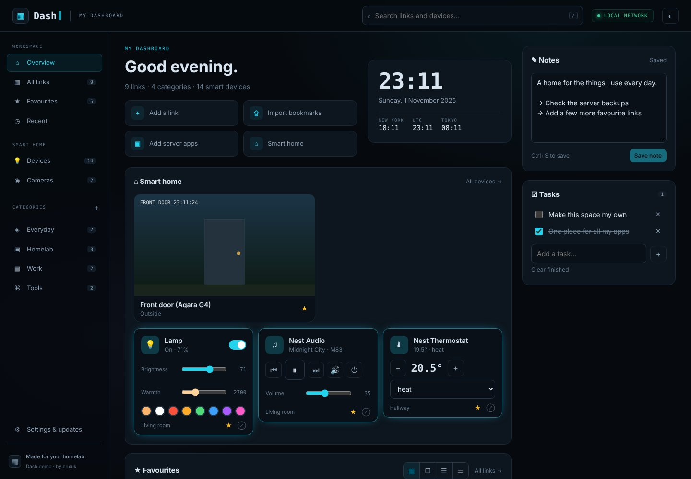

<div align="center">

# `▦` Dash

**Your links. Your apps. Your smart home. Your everyday launchpad.**

A modern personal dashboard for your local network. Save your favourite sites, organise your homelab,
check the time, switch the lights and get on with your day. Inspired by [HomeLabStats](https://github.com/bhxuk/HomeLabStats).

[**Website**](https://bhxuk.github.io/Dash/) · [**Interactive demo**](https://bhxuk.github.io/Dash/demo/) ·
[Install](#install) · [Releases](https://github.com/bhxuk/Dash/releases) · [Changelog](CHANGELOG.md)



</div>

## Features

| Area | What you get |
|---|---|
| Dashboard | Dark navy panels, cyan accents, a sidebar, responsive cards and a light theme |
| Clock & date | UK date formatting, configurable main time zone, optional seconds, New York / UTC / Tokyo clocks |
| Links & apps | Add, edit, delete, pin, categorise and search your own shortcuts |
| Smart home | Lights, Google Nest speakers and Chromecasts, thermostats, plugs, sensors and scenes through Home Assistant, grouped by room |
| Cameras | Live-refreshing snapshots and a full-screen live view for Aqara and other Home Assistant cameras |
| Bulk import | Paste URL lists, named lists, CSV/TSV and Markdown, or select .url / .webloc / text / HTML bookmark files; preview, deduplicate and choose categories |
| Layouts | Smaller compact cards by default, classic cards, table/list rows and an Android TV-inspired launcher with category shelves and keyboard navigation |
| Organisation | Custom order, drag and drop, keyboard move buttons, alphabetical / frequent / recent sorting |
| Previews | Details panel, your own preview image URL and an optional sandboxed live website preview |
| Homelab starter | One-click shortcuts for Plex, the *arr apps, qBittorrent, Seerr, Tautulli, Home Assistant, Portainer, Glances, ROMM, PDFDing and more, with editable ports |
| Everyday extras | A small task list |
| Appearance | Dark/light theme, six accent colours, three backgrounds and compact cards |
| Data | Server-side JSON storage, export/import, snapshots and conflict detection across browser tabs |
| Updates | Published-release checks, changelog, one-click update, pre-update validation and backup, automatic code rollback if startup fails |

**No login. No cloud account. No Docker socket. No frontend build step.**
One Python service with no third-party Python packages. Links and settings live in `./data/dashboard.json` and the Home Assistant connection in `./data/homeassistant.json`, outside the source tree tracked by Git.

## Install

Requires Linux, Docker Engine with Compose v2, and Git. Run these commands as the user who owns your Docker projects:

```bash
git clone https://github.com/bhxuk/Dash.git
cd Dash
bash install.sh
```

The installer creates `data/` and a `.env` file, sets the checkout owner's UID/GID, detects the server's LAN IP and builds/starts the container. Check the printed LAN address. Open **`http://<your-server-ip>:8088`** using that address.

### Manual Docker Compose setup

```bash
git clone https://github.com/bhxuk/Dash.git
cd Dash
mkdir -p data
cp .env.example .env
nano .env
# Set LAN_IP to this server's LAN address.
# Set PUID and PGID to the results of id -u and id -g.
docker compose up -d --build
```

Open `http://<LAN_IP>:8088`. Dash binds to the specific LAN address configured in `.env`. Without a `.env` file it defaults to loopback only. No port forwarding, Funnel or public reverse proxy is needed.

The container runs as the configured UID/GID. Your checkout and data folder must be writable by that user. The source is mounted at `/app` so updates can be applied without mounting Docker's socket.

### First run

1. Choose **Add a link**, **Import bookmarks** (any browser's bookmark export works) or **Add server apps** for your homelab.
2. For server apps, enter the server IP, tick the apps you run and check the ports. Ports are editable defaults, not auto-discovered services.
3. Use **+** beside Categories to create, rename, re-icon, reorder or delete groups. Deleting a category moves its links to another one.
4. Click a link to open it. Hover a link for ☆ pin, ◉ preview and ✎ edit.
5. Connect Home Assistant under **Settings & updates → Smart home** (see below).
6. Press `/` to search links and devices, and `n` to add a link.

Most websites block embedded viewing or require cookies that do not work in frames. Dash always provides a direct Open website link. Preview images are optional URLs you supply; Dash does not capture screenshots, proxy private websites or copy their login sessions. Local HTTPS apps with self-signed certificates may need to be opened directly first.

If another browser has edited the dashboard, Dash reloads the latest copy instead of silently overwriting it.

## Smart home (lights, Aqara cameras, Google devices)

Dash controls devices **through Home Assistant**, so your devices need to be added there first. Home Assistant talks to almost everything; Dash gives you a fast, tidy control panel on top.

1. **Add your devices to Home Assistant** (Settings → Devices & services):
   - **Google Nest speakers, Nest Hubs, Chromecasts:** usually discovered automatically as *Google Cast*. Click **Configure**. Nest thermostats and Nest cameras use the *Google Nest* integration.
   - **Aqara cameras and hubs (G2H Pro, G3, G5, M2, M3):** use the *HomeKit Device* integration with the HomeKit code on the device (the M3 also supports *Matter*). For smoother live video, turn on **RTSP LAN preview** in the Aqara Home app and add the `rtsp://` address with the *Generic Camera* integration.
   - **Smart bulbs:** add your bulb brand's integration (Philips Hue, TP-Link Kasa/Tapo, LIFX, WiZ, Govee, Yeelight, Tuya, IKEA, Matter…).
2. **Create a token** in Home Assistant: your profile (bottom left) → **Security** → **Long-lived access tokens** → **Create token**.
3. In Dash open **Settings & updates → Smart home**, enter your Home Assistant address (for example `http://192.168.0.10:8123`) and paste the token. Dash tests the connection before saving.
4. Open **Smart home → Devices** or **Cameras**. Star ★ any device to pin it to your overview.

The token is stored in `data/homeassistant.json` (readable only by the Dash user), is never sent to the browser and is not part of exports. Dash can only send a fixed set of actions (on/off, brightness, colour, media controls, volume, thermostat temperature and mode, blinds, vacuum, scenes and scripts). Locks and alarms are shown read-only. Anyone on your LAN who can open Dash can switch devices, as with the rest of the dashboard.

## Bulk import & layouts

Click **Import** beside Add link (or **Import bookmarks** on the overview). Paste one URL per line or a named list:

```text
Plex | http://server.local:32400/web | Media
GitHub | https://github.com | Tools
https://example.com
```

Choose **Review pasted links**, or **Choose files** for multiple Windows Internet Shortcut (`.url`), Mac `.webloc`, `.txt`, `.csv`, `.tsv`, `.md` or HTML bookmarks exports. CSV/TSV can include Name, URL, Category and Description headers. UTF-8 and BOM-marked UTF-16 shortcut files are supported.

The review table flags invalid URLs and duplicates. Select the links to add, choose a default category and optionally pin them. Named categories are matched case-insensitively or created. Import appends links, keeps existing content and makes a server snapshot first. Limits: 4 MB per import, 2,000 links and 50 categories in the dashboard. Windows desktop `.lnk` files are identified and skipped; use `.url` shortcuts for website addresses.

Use the **layout selector** above your links, or **Settings → Appearance → Layout**:

- **Compact:** smaller cards with short descriptions, designed for lots of links. This is the new default.
- **Cards:** the original card layout, with reduced padding.
- **Table / list:** one row per link, with Name, URL, Category, Opened and action columns.
- **TV launcher:** wide tiles in horizontal category shelves. Tab to a link, use the arrow keys to move between tiles, and Enter to open it. Optional preview images become tile artwork. Use the fullscreen button for a cleaner launcher screen.

Layouts preserve the same links, favourites, search, previews and sorting. The TV design is inspired by a TV launcher; it runs in your browser.

## Updates

Dash installs new releases **automatically**: it checks GitHub two minutes after starting and then every hour, and installs any newer stable release using the safe process below. Open pages reload themselves afterwards. To update by hand instead, untick **Settings & updates → Updates → Install updates automatically**; Dash then shows a banner with **Update now** when a release is ready.

Dash fetches the exact release tag from `bhxuk/Dash`, checks that it is a fast-forward of your install, validates its version and runs its self-tests in a temporary Git worktree. It then creates a dashboard snapshot, fast-forwards the source and restarts the app. The immutable Docker supervisor waits up to 30 seconds for the new version's health endpoint. If startup fails, it restores the previous source commit and keeps your dashboard data. An update result is stored in `data/update-result.json`.

The UI reconnects automatically. An interrupted update's pending marker is processed on the next container start. Local source edits block automatic updates rather than being overwritten. Internet access to GitHub is required for checks and updates; the dashboard itself works on an offline LAN.

The supervisor and Python base image are deliberately outside in-app source updates. If a release changes either, run the full manual rebuild described in its release notes:

```bash
git pull --ff-only
docker compose up -d --build
```

A versioned image is also built to `ghcr.io/bhxuk/dash` by GitHub Actions. Compose builds locally by default so installation does not depend on registry package visibility.

## Backups & recovery

- **Export backup** downloads all dashboard content as JSON.
- **Import backup** validates a Dash JSON export and makes a server snapshot before replacing the dashboard.
- **Create snapshot** writes a timestamped file to `data/backups/`. Copy snapshots off the server for an independent backup.
- Imports and updates create additional snapshots automatically. Snapshots are retained until you remove them.
- To restore a server snapshot, download/copy that JSON file and use **Import backup**. Alternatively stop Dash, copy the snapshot to `data/dashboard.json`, preserve its ownership, and start Dash again.
- Deleting a container does not delete `./data`. Deleting the data folder does.

## Configuration

| Variable | Default | Purpose |
|---|---|---|
| `LAN_IP` | `127.0.0.1` without `.env` | Host address Docker publishes on; set to the server LAN IP |
| `DASH_PORT` | `8088` | Host port; internal container port stays 8088 |
| `PUID`, `PGID` | `1000` | User/group owning the checkout and data |
| `DASH_HOSTNAMES` | empty | Optional local DNS names, comma-separated, e.g. `dash.home.arpa` |
| `TZ` | `Europe/London` | Container timezone |

The main dashboard clock timezone is configured in the UI. Changes are shared across devices using this dashboard.

## LAN access

No authentication is enabled, as requested. Everyone who can reach Dash on your trusted LAN can edit it and trigger updates. The service accepts RFC1918, loopback, link-local and IPv6 ULA clients, and checks Host/Origin on writes to reduce cross-site requests and DNS rebinding. It does not trust forwarded IP headers. These checks do not replace network isolation: do not expose the service through a public proxy or forward its port.

No remote access or Tailscale routing is configured. Dash launches web app URLs; it does not install or control desktop programs. The dashboard runs without Docker socket access, host PID mode or privileged containers.

## Troubleshooting

```bash
docker compose ps
docker compose logs --tail=100 dash
docker compose restart dash
```

- **Cannot open it:** verify `LAN_IP` belongs to the server, check the host firewall allows your LAN to reach `DASH_PORT`, then inspect Compose logs.
- **Permission denied:** match `PUID`/`PGID` to the checkout owner and ensure `data/` is writable. Recreate with `docker compose up -d`.
- **Host not allowed:** use the LAN IP, a `.local` name, or add your local DNS name to `DASH_HOSTNAMES` and recreate the container.
- **Port in use:** change `DASH_PORT` in `.env`, then recreate the container.
- **Update refused:** run `git status`. Back up and commit or stash source edits, then retry. `.env` and `data/` are ignored by Git.
- **Bad dashboard JSON:** Dash does not silently reset it. Stop the container and restore a known-good snapshot.

## Development & publishing

```bash
python3 -m unittest discover -s tests -v
node --test tests/importer.test.cjs
DATA_DIR=./data PORT=8088 python3 -m app.main
python3 scripts/build_pages.py
```

The app backend is in `app/`, frontend in `app/static/`, and Docker supervisor in `scripts/`. The public demo reuses the exact frontend with browser-local storage and sample data. It never connects to your server.

Every release must bump `app/VERSION` and add a matching `CHANGELOG.md` entry. CI tests the API and storage, checks frontend syntax and builds Docker. Successful main builds publish a release, a container image and the Pages site. The initial Pages setup may need **Settings → Pages → Source: GitHub Actions** if repository administration is unavailable to the workflow. Code commits are attributed to **bhxuk**; generated deployments and releases are handled by GitHub Actions.

## Licence

[MIT](LICENSE). Created by [bhxuk](https://github.com/bhxuk). Visual direction inspired by HomeLabStats.
